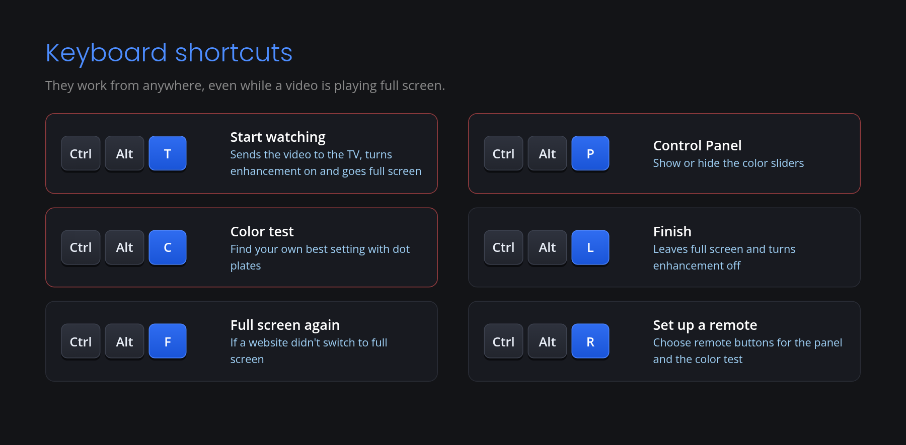
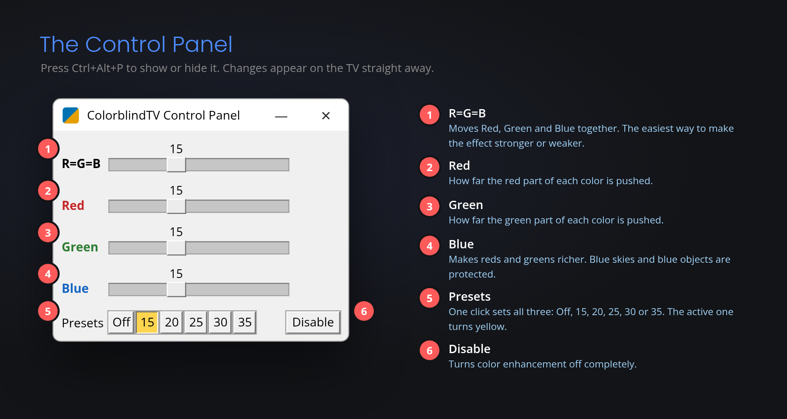
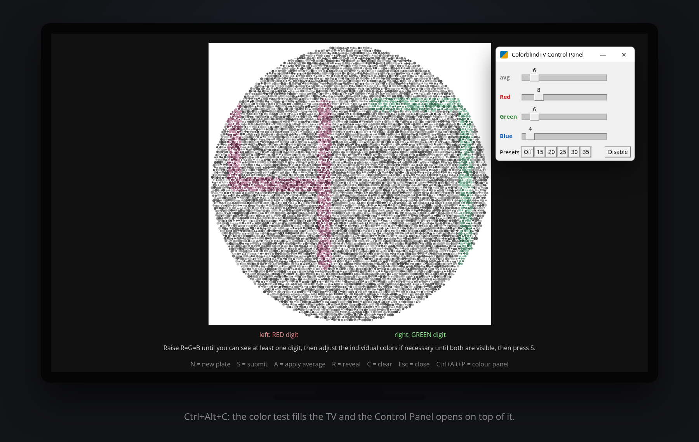

# ColorblindTV User Guide

**See colors more like others see them.**

ColorblindTV runs on an ordinary Windows PC connected to your TV. This guide explains how to download and install it, and how to use its two most important tools: the **Control Panel**, which sets the strength of the color enhancement, and the **Color Test**, which helps you find the setting that works best for your own eyes.

**Contents:** [What you need](#what-you-need) · [Download](#download) · [Install](#install) · [Keyboard shortcuts](#keyboard-shortcuts) · [Control Panel](#the-control-panel-ctrlaltp) · [Color Test](#the-color-test-ctrlaltc) · [Remote control](#using-a-remote-control-ctrlaltr) · [Turning it off or removing it](#turning-it-off-or-removing-it) · [Troubleshooting](#troubleshooting)

---

## What you need

- A Windows 10 or Windows 11 PC (64-bit).  I use a mini PC, BMax Mini PC B4 Ultra, and leave it on continuously.
- An HDMI cable connecting the PC to your TV
- Microsoft Edge, which is already on every Windows PC, for watching Netflix, YouTube, Prime Video, Xfinity and other services
- A keyboard and mouse. I use the Logitech K400 Plus Wireless Keyboard.  A wireless TV-style remote is optional (I use the Rii MX3 air mouse).

The color-enhanced picture is shown on the TV. The PC's own screen (for example, a laptop screen) is not changed. Only video that plays on the PC is enhanced. Cable boxes, antennas, streaming devices and the TV’s own apps which  send video straight to the TV are not color enhanced.

## Download

### **[Download ColorblindTV for Windows](https://github.com/medhed9/ColorblindTV/releases/download/v1.0.7/ColorblindTV_Setup_1.0.7.exe)**

Version 1.0.7 · 36 MB · Windows 10 and 11 (64-bit) · Free

## Install

1. Connect the PC to the TV and turn the TV on.
2. Click the download link above. If your browser says the file "isn't commonly downloaded," click **⋯ → Keep** (Edge) or **Keep** (Chrome).
3. Open your Downloads folder and double-click **ColorblindTV_Setup_1.0.7.exe**.
4. **If Windows warns you:** Windows may show a blue box saying **"Windows protected your PC."** This appears because ColorblindTV is new and not yet registered with Microsoft. Click **More info**, then **Run anyway**.
5. When Windows asks **"Do you want to allow this app to make changes to your device?"**, click **Yes**.
6. Click **Next**, read the notice, and click **I Agree**.
7. Wait a few minutes while setup finishes. No internet connection is needed: everything ColorblindTV uses is included in the download. Setup checks your PC's graphics and installs the right version automatically.
8. Click **Finish**. ColorblindTV now starts by itself every time you sign in to Windows.

## Keyboard shortcuts

ColorblindTV is controlled with a few keyboard shortcuts. They work from anywhere, even while a video is playing full screen.

| Shortcut | What it does |
|---|---|
| **Ctrl+Alt+T** | Start watching: sends the video to the TV, turns the enhancement on and goes full screen |
| **Ctrl+Alt+P** | Show or hide the Control Panel |
| **Ctrl+Alt+C** | Open the Color Test |
| **Ctrl+Alt+L** | Finish: leaves full screen and turns the enhancement off |
| **Ctrl+Alt+F** | Full screen again, if a website didn't switch to full screen |
| **Ctrl+Alt+R** | Choose buttons on a TV-style remote for the Control Panel and the Color Test |

### Watching TV

1. Open a video in Edge.
2. Press **Ctrl+Alt+T**. The picture moves to the TV, the enhancement turns on and the video fills the screen.
3. When you are finished, press **Ctrl+Alt+L**.

## The Control Panel (Ctrl+Alt+P)

The Control Panel sets how strong the color enhancement is. Press **Ctrl+Alt+P** to show it, and again to hide it. It stays on top of a full-screen video, and the TV changes as you move each slider, so you can watch the effect while you adjust it.

1. **R=G=B:** Moves Red, Green and Blue together. This is the easiest way to make the effect stronger or weaker. When Red, Green and Blue are set to different values, its label changes to "avg" and it shows their average.
2. **Red** and 3. **Green:** Set how much the red and green parts of each color can change. Where a color has more red than green, ColorblindTV raises the red and lowers the green; where it has more green, it does the opposite. Colors with equal red and green, such as white, grey and black, are never changed.
4. **Blue:** Lowers the blue in reddish and greenish colors so they look richer and more vivid. Colors that are mainly blue, such as a blue sky, are protected.
5. **Presets:** One click sets all three sliders to Off, 15, 20, 25, 30 or 35. The active preset turns yellow.
6. **Disable:** Turns the enhancement off. Moving any slider or choosing a preset turns it back on.

Each slider goes from 0 (no change) to 40 (strongest). Click anywhere on a slider to jump straight to that spot, or drag it. The arrow keys move it one step at a time. ColorblindTV starts at 15, and your settings are saved automatically for next time.

### What the numbers mean

Every pixel on the screen is made of three tiny lights: red, green and blue. Each one has a brightness from **0** (off) to **255** (full brightness), and the mix of the three makes the pixel's color.

The number on each slider is the **largest amount ColorblindTV is allowed to change that color in a pixel**, up or down, on that 0–255 scale. For example, with Red set to **20**, the red part of a pixel can be raised or lowered by up to 20 steps out of 255. With the slider at **0**, that color is never changed.

The slider sets the *maximum*. Most pixels are changed by less than this, since the amount of change is based on the red-green difference at that pixel. Therefore colors with equal values of red and green are not changed at all. For comparison, the strongest setting, 40, is about one-sixth of the full 0–255 range.

## The Color Test (Ctrl+Alt+C)

Everyone's color vision is different, so the best setting is personal. The Color Test helps you find yours, using dot plates similar to the ones used to test color vision.

### How the plates work

Each plate hides two random numbers. The number on the left is made of dots that are slightly redder than the grey background, and the number on the right is made of dots that are slightly greener. The background dots vary in brightness, so the only way to see a number is to tell red from green, which is exactly the difference ColorblindTV magnifies.

### Finding your setting

1. Press **Ctrl+Alt+C**. The enhancement turns on, a plate fills the TV and the Control Panel opens on top. Every new plate starts with all the sliders at 0.
2. Slowly raise the **R=G=B** slider until you can see at least one of the two numbers.
3. If you can see only one, adjust **Red**, **Green** or **Blue** a little at a time until you can see both.
4. Press **S** to submit. ColorblindTV records your settings and shows a new plate, with the sliders back at 0.
5. Repeat with a few more plates. The bottom of the screen shows how many plates you have submitted and the average of your settings.
6. Press **A** to apply the average. It becomes your everyday setting and is remembered.
7. Press **Esc** to close the Color Test.

### Other keys in the Color Test

| Key | What it does |
|---|---|
| **N** or **Space** | New plate, without submitting this one |
| **R** | Reveal: shows the two numbers, so you can check yourself (press again to hide them) |
| **C** | Clear the plates you have submitted and start again |

These keys also work while the Control Panel is the active window.

*The Color Test is for adjusting ColorblindTV only. It is not a medical test of color vision.*

### Try it: can you see both numbers?

This sample plate is shown without any enhancement. People with typical color vision see a 4 on the left and a 7 on the right.

## Using a remote control (Ctrl+Alt+R)

If you use a wireless TV-style remote with your PC, you can choose two of its buttons: one that shows or hides the Control Panel, and one that opens or closes the Color Test.

1. Press **Ctrl+Alt+R**.
2. When asked, press the remote button you want for the Control Panel.
3. Then press the button you want for the Color Test.

Press **Esc** at either step to keep the button you already have. The arrow buttons and OK can't be used, because you need them to move around. Your choices are saved for next time.

## Turning it off or removing it

- Press **Ctrl+Alt+L**, or click **Disable** in the Control Panel, to turn the enhancement off at any time.
- To remove ColorblindTV, go to Windows **Settings > Apps > Installed apps > ColorblindTV > Uninstall**.

## Troubleshooting

- **"Windows protected your PC":** Click **More info**, then **Run anyway**.
- **Your antivirus program blocks setup:** Allow ColorblindTV_Setup_1.0.7.exe in your antivirus program and run it again.
- **Nothing appears on the TV:** Check that the TV is set to the HDMI input the PC is plugged into.
- **Questions or problems:** Email [colorblindtv9@gmail.com](mailto:colorblindtv9@gmail.com), or ask in [Discussions](https://github.com/medhed9/ColorblindTV/discussions).

---

ColorblindTV is a color enhancement tool. It is not a medical device, and it does not diagnose, treat or cure color blindness.

More information: [colorblindtv.com](https://colorblindtv.com)
